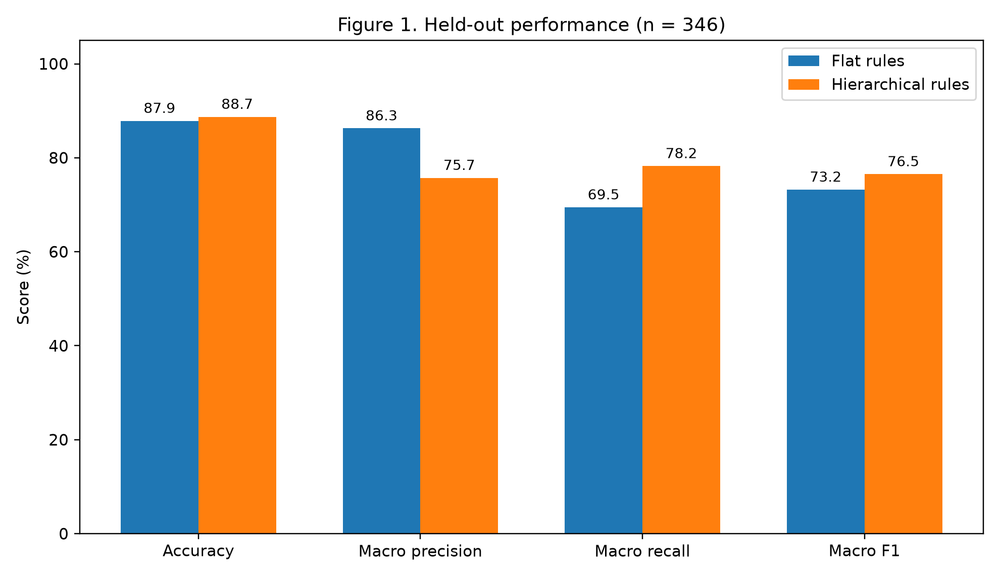
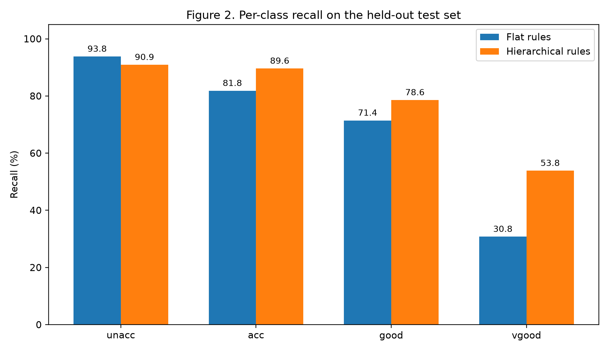
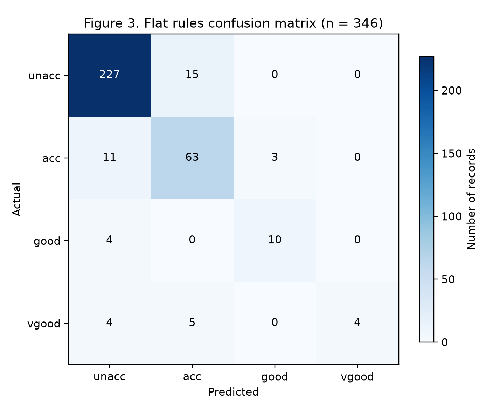
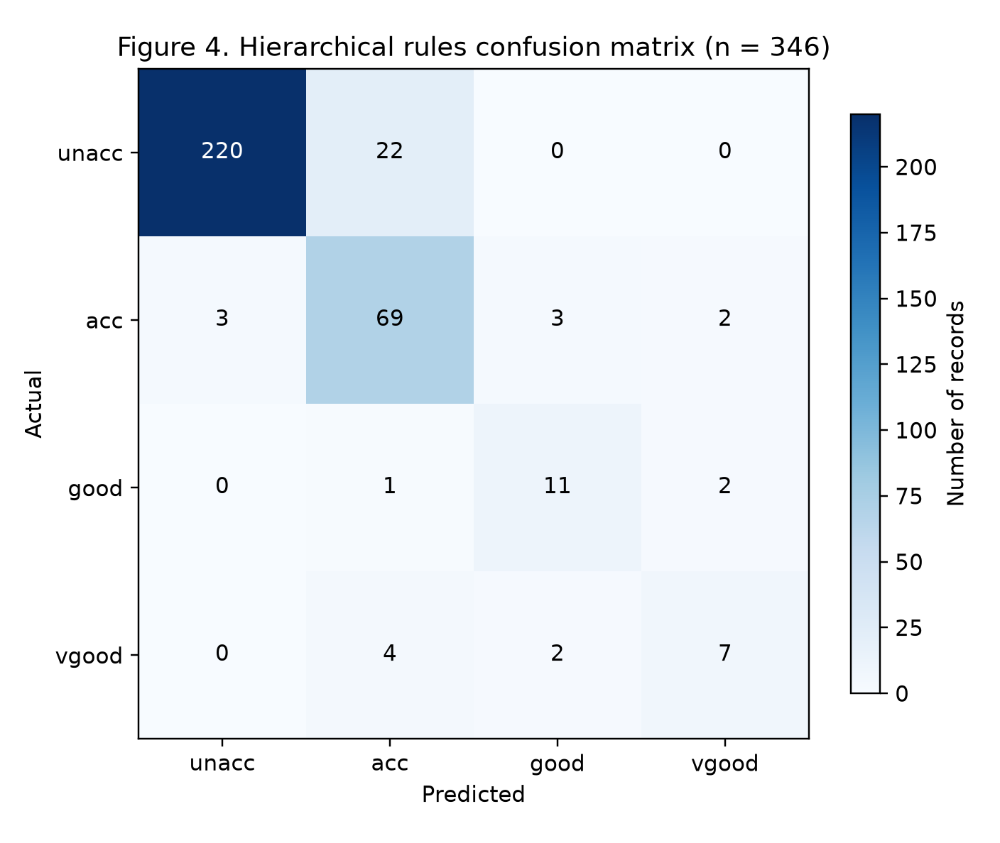

# Car Acceptability: Flat and Hierarchical Rule-Based Classification

**A comparative experimental study using the UCI Car Evaluation Dataset**

**Institution:** Bath Spa University  
**Module:** Artificial Intelligence (CPU5006-20P)  
**Assessment:** Assessment 1 — Rule-Based AI Experiments  
**Researcher:** Ozgur Serin  
**Language:** Python  
**Dataset:** [UCI Car Evaluation](https://doi.org/10.24432/C5JP48)

---

## 1. Project overview

This project develops and evaluates two **transparent, rule-based classifiers** for predicting car acceptability. Both models operate on the same six categorical vehicle attributes, but they represent decisions differently:

- **Flat rule-based classifier:** learns an ordered list of IF–THEN rules by sequential covering of labelled training examples.
- **Hierarchical rule-based classifier:** uses researcher-defined intermediate `PRICE`, `COMFORT`, and `TECH` rules, then learns a final label lookup from the training data.

The objective is not simply to maximise accuracy, but to investigate the trade-offs between rule structure, classification performance, minority-class recognition and interpretability. The project includes a **fixed held-out test set**, **five exploratory repeated splits**, **an additional representation comparison**, saved results and unit tests.

> **Scope:** These are interpretable rule-based systems, not neural networks. The intermediate hierarchy is a constructed approximation; it is **not** claimed to reproduce the UCI dataset's original expert decision model.

## 2. Research question and objectives

**Research question:** How do flat and hierarchical rule-based classifiers compare when predicting acceptability labels in the UCI Car Evaluation Dataset?

**Objectives**

1. Implement two distinct rule-based classification architectures using the same categorical inputs.
2. Compare generalisation performance on an untouched stratified holdout set.
3. Evaluate per-class behaviour, especially for the less frequent `good` and `vgood` classes.
4. Explore the stability of the comparison across additional stratified splits.
5. Document the decision logic, experimental settings, limitations and steps required to reproduce the analysis.

## 3. Dataset

The **Car Evaluation** dataset contains **1,728 records**, with six categorical input attributes and one target label. The project loads `data/car.data` using the field names in `src/models.py` and preserves the original category labels.

| Input feature | Meaning | Values |
|:--|:--|:--|
| `buying` | Buying price | `vhigh`, `high`, `med`, `low` |
| `maint` | Maintenance cost | `vhigh`, `high`, `med`, `low` |
| `doors` | Number of doors | `2`, `3`, `4`, `5more` |
| `persons` | Passenger capacity | `2`, `4`, `more` |
| `lug_boot` | Luggage compartment | `small`, `med`, `big` |
| `safety` | Safety rating | `low`, `med`, `high` |

### Target-class distribution

| Class | Meaning | Records | Share |
|:--|:--|--:|--:|
| `unacc` | Unacceptable | 1,210 | 70.0% |
| `acc` | Acceptable | 384 | 22.2% |
| `good` | Good | 69 | 4.0% |
| `vgood` | Very good | 65 | 3.8% |
| **Total** | | **1,728** | **100%** |

The distribution is imbalanced: a model can achieve apparently strong overall accuracy while making frequent mistakes on minority classes. For this reason, **macro-F1 is the primary evaluation metric**; accuracy, macro-precision, macro-recall, per-class recall and confusion matrices provide supporting evidence.

The data-loading routine in `src/run_experiment.py` also checks the expected dimensions, missing values, duplicate feature combinations and valid class labels.

## 4. Algorithm A — Flat rule-based classifier

**Implementation:** [`src/models.py`](src/models.py), class `FlatRuleClassifier`.

The flat model constructs candidate conjunctions of **one to three attribute conditions** from the training data. It repeatedly selects a qualifying rule to cover remaining training cases, producing an **ordered decision list**. At prediction time, the **first matching rule** determines the label; if none matches, the model returns the training-set majority class.

The default rule-selection controls are recorded in the code and frozen methodology file:

| Parameter | Value | Purpose |
|:--|--:|:--|
| `max_conditions` | 3 | Maximum conditions in one rule |
| `min_support` | 8 | Minimum covered training records |
| `min_purity` | 0.72 | Minimum majority-label proportion among covered records |
| `max_rules` | 65 | Maximum rules in the ordered list |

**Illustrative rule format (not a verbatim learned rule):**

```text
IF safety = low AND persons = 2 THEN class = unacc
```

The actual learned rule set depends on the training partition. The `explain()` method identifies the matched rule number and its conditions, or reports the fallback decision.

**Strengths:** data-derived rules, readable decisions, explicit ordering.  
**Limitations:** rule ordering and the majority-class fallback affect predictions; candidate coverage and purity constraints may disadvantage uncommon patterns.

## 5. Algorithm B — Hierarchical rule-based classifier

**Implementation:** [`src/models.py`](src/models.py), class `HierarchicalRuleClassifier`.

The hierarchical model constructs intermediate symbolic assessments before producing a final classification:

```text
buying + maint --------------------> PRICE
persons + doors + lug_boot --------> COMFORT
safety + COMFORT ------------------> TECH
PRICE + TECH --> training-learned label lookup --> predicted class
```

| Stage | Implementation behaviour |
|:--|:--|
| `PRICE` | Takes the higher cost level of `buying` and `maint` |
| `COMFORT` | Applies explicit rules based on passenger capacity, doors and luggage space |
| `TECH` | Combines safety and the computed comfort category |
| Final label | Uses the majority class observed for each `(PRICE, TECH)` combination in the training data |

For an unseen terminal combination, the classifier falls back to the overall training-majority class. Its `explain()` output exposes `PRICE`, `COMFORT`, `TECH`, the final prediction and a summary of the final lookup condition.

**Strengths:** visible intermediate reasoning, concise domain-based abstraction.  
**Limitations:** the designed intermediate rules may discard useful original-feature information, and terminal label groups depend on the available training examples.

**Important distinction:** Intermediate rules are specified in code; **only the final lookup is learned** from labelled training data. This is different from the flat model's learned decision list.

## 6. Experimental methodology

### 6.1 Fixed development and final-holdout protocol

The main experiment uses stratified splits with **random seed 42**:

```text
Original dataset (1,728)
             |
             +-- Development (80%; 1,382)
             |       |
             |       +-- Training (75% of development)
             |       +-- Validation (25% of development)
             |
             +-- Final holdout (20%; 346)  <-- reserved until settings frozen
```

Both models are first fitted and checked on the development train/validation partition. After design choices are frozen, they are refitted to all development data and evaluated against the reserved 346-record holdout. The holdout results are already stored in `outputs/FINAL_holdout_results.json`.

The pre-final settings are documented in [`METHODOLOGY_FROZEN.json`](METHODOLOGY_FROZEN.json), including the model defaults, split procedure, primary metric and date of freezing. **Final holdout results must not be used for further tuning and then presented as an untouched confirmatory test.**

### 6.2 Exploratory repeated-split evaluation

An additional evaluation uses **five paired, stratified 80/20 splits** with seeds `11`, `23`, `37`, `53`, and `71`. Both classifiers are fitted to the training portion and evaluated on the corresponding test portion for each seed.

These repetitions provide a **sensitivity / stability check**, not five independent confirmatory studies. Their test sets overlap with one another and are not equivalent to an independent external dataset.

### 6.3 Controlled representation comparison

A supplementary script compares a flat classifier trained on the original six features against a flat classifier trained on derived `PRICE`, `COMFORT`, and `TECH` representation values. The second representation is computed from the hierarchical model's intermediate rules. This is an exploratory probe of representation effects; **it is not a direct replacement for the main flat-versus-hierarchical evaluation**.

## 7. Main results — fixed holdout

**Test set:** 346 records, stratified 20% holdout, seed 42. Values below are taken from `outputs/FINAL_holdout_results.json` and `outputs/final_summary.csv`.

| Metric | Flat rules | Hierarchical rules |
|:--|--:|--:|
| Accuracy | 0.8786 (87.86%) | **0.8873 (88.73%)** |
| Macro-precision | **0.8628** | 0.7573 |
| Macro-recall | 0.6945 | **0.7823** |
| **Macro-F1 (primary)** | 0.7323 | **0.7652** |
| Correct cases | 304 / 346 | **307 / 346** |

The hierarchical model achieved a **0.0329 higher macro-F1** and **three more correct predictions** on this specific fixed test set. The difference is modest and should not be interpreted as proof that the hierarchical approach is universally superior.

### Minority-class recall on the final holdout

| Class | Holdout support | Flat recall | Hierarchical recall |
|:--|--:|--:|--:|
| `unacc` | 242 | **0.9380** | 0.9091 |
| `acc` | 77 | 0.8182 | **0.8961** |
| `good` | 14 | 0.7143 | **0.7857** |
| `vgood` | 13 | 0.3077 | **0.5385** |

The small minority-class supports (14 and 13 cases) make individual recall estimates sensitive to a few predictions. This is one reason to report class-level metrics as well as macro-F1.


### Detailed per-class precision, recall and F1

| Model | Class | Precision | Recall | F1 |
|:--|:--|--:|--:|--:|
| Flat rules | `unacc` | 0.9228 | 0.9380 | 0.9303 |
| Flat rules | `acc` | 0.7590 | 0.8182 | 0.7875 |
| Flat rules | `good` | 0.7692 | 0.7143 | 0.7407 |
| Flat rules | `vgood` | 1.0000 | 0.3077 | 0.4706 |
| Hierarchical rules | `unacc` | 0.9865 | 0.9091 | 0.9462 |
| Hierarchical rules | `acc` | 0.7188 | 0.8961 | 0.7977 |
| Hierarchical rules | `good` | 0.6875 | 0.7857 | 0.7333 |
| Hierarchical rules | `vgood` | 0.6364 | 0.5385 | 0.5833 |

*Source: [`outputs/final_per_class.csv`](outputs/final_per_class.csv). Values are rounded to four decimal places.*

### Figures: model results and confusion matrices



*Figure 1. Model comparison generated from saved experimental results.*



*Figure 2. Per-class recall on the final holdout.*

| Flat model | Hierarchical model |
|:--:|:--:|
|  |  |

*Figures 3–4. Confusion matrices for the two classifiers.*

An existing combined overview is also retained below:


## 8. Additional exploratory results

### Five paired splits

| Metric (mean across five splits) | Flat | Hierarchical |
|:--|--:|--:|
| Accuracy | **0.8850** | 0.8607 |
| Macro-F1 | **0.7615** | 0.7249 |
| Macro-recall | **0.7525** | 0.7486 |

### Seed-by-seed results

| Seed | Flat accuracy | Hierarchical accuracy | Flat macro-F1 | Hierarchical macro-F1 |
|--:|--:|--:|--:|--:|
| 11 | 0.9046 | 0.8786 | **0.7850** | 0.7324 |
| 23 | 0.9075 | 0.8757 | **0.8131** | 0.7839 |
| 37 | 0.8642 | 0.8439 | **0.7498** | 0.6953 |
| 53 | 0.9220 | 0.8613 | **0.7796** | 0.7135 |
| 71 | 0.8266 | 0.8439 | 0.6800 | **0.6992** |

*Source: [`outputs/repeated_split_results.csv`](outputs/repeated_split_results.csv). Bold indicates higher macro-F1 for that seed.*

The flat model had higher macro-F1 on **four of the five** exploratory paired splits. The signed hierarchical-minus-flat macro-F1 differences were `-0.0525`, `-0.0292`, `-0.0546`, `-0.0661`, and `+0.0193`.

**Interpretation:** The fixed holdout favoured the hierarchical model, whereas most supplementary splits favoured the flat model. Together, these observations indicate **split-dependent performance** rather than a robust overall winner.

### Representation-control experiment

The supplementary [`run_controlled.py`](run_controlled.py) experiment compares the flat learner using the original six attributes versus transformed intermediate inputs. The original representation achieved higher macro-F1 on all five recorded seeds. See [`outputs/controlled_representation_results.csv`](outputs/controlled_representation_results.csv) for seed-level values. This supports caution when replacing detailed attributes with compressed intermediate categories.


### Representation comparison: individual runs

| Seed | Original six inputs: macro-F1 | PRICE/COMFORT/TECH: macro-F1 | Original rules | Transformed rules |
|--:|--:|--:|--:|--:|
| 11 | **0.7850** | 0.6898 | 21 | 10 |
| 23 | **0.8131** | 0.6375 | 15 | 9 |
| 37 | **0.7498** | 0.6192 | 23 | 7 |
| 53 | **0.7796** | 0.6651 | 14 | 12 |
| 71 | **0.6800** | 0.6776 | 25 | 9 |

*Source: [`outputs/controlled_representation_results.csv`](outputs/controlled_representation_results.csv). The comparison concerns feature representation and is exploratory.*

## 9. Project structure

```text
Rule_Based_AI_Car_Evaluation_CPU5006/
├── README.md
├── requirements.txt
├── data/
│   ├── car.data
│   └── car.c45-names
├── src/
│   ├── models.py
│   └── run_experiment.py
├── tests/
│   └── test_models.py
├── outputs/
│   ├── FINAL_holdout_results.json
│   ├── development_validation.json
│   ├── final_summary.csv
│   ├── final_per_class.csv
│   ├── repeated_split_results.csv
│   ├── repeated_split_summary.json
│   └── controlled_representation_results.csv
├── figures/
│   ├── research_cover.png
│   ├── figure_1_model_comparison.png
│   ├── figure_2_per_class_recall.png
│   ├── figure_3_confusion_matrix.png
│   └── figure_4_confusion_matrix.png
├── Experimental Results_ Rules and Confusion Matrices (1).png
├── make_figures.py
├── run_additional.py
├── run_controlled.py
├── METHODOLOGY_FROZEN.json
├── DATASET_SHA256.txt
└── FILE_CHECKSUMS.txt
```

`src/models.py` contains the two classifier implementations; `src/run_experiment.py` handles the main splits and saved evaluation. The scripts at the repository root handle additional analysis and figure generation. CSV and JSON outputs are included so results can be examined without rerunning the final holdout.

## 10. Installation and reproduction

### Prerequisites

- Python **3.10 or later** (within the supported versions of the packages in `requirements.txt`)
- `numpy`, `pandas`, `scikit-learn`, and `matplotlib`

From the project root:

```bash
python -m pip install -r requirements.txt
```

### Run the unit tests

```bash
python -m unittest discover -s tests -v
```

The four existing tests check valid prediction labels, hierarchical explanation fields and deterministic flat-model predictions. They are **smoke/unit checks**, not a comprehensive test suite.

### Development-only validation (safe default)

```bash
python src/run_experiment.py
```

This writes `outputs/development_validation.json`. It **does not evaluate the sealed holdout**.

### Main final-holdout mode — archival / deliberate use only

```bash
python src/run_experiment.py --final-test
```

**Caution:** The command above re-runs the previously finalised holdout and overwrites `outputs/FINAL_holdout_results.json`. It is included for reproducibility, **not for retuning**. Use the existing stored results when simply reviewing the assessment.

### Additional analyses and figures

```bash
python run_additional.py
python run_controlled.py
python make_figures.py
```

The additional scripts write to the corresponding files under `outputs/`; figure generation uses the saved results. Running these scripts can overwrite existing generated artefacts, so make a backup if you need to preserve the exact archived copies.

## 11. Interpretation, limitations and validity

- **No universal winner:** Hierarchical rules had the stronger fixed holdout macro-F1, but flat rules won on four of five exploratory splits.
- **Dataset imbalance:** `unacc` dominates, while `good` and `vgood` have small holdout supports.
- **Rule design differs:** The flat learner learns ordered rules, whereas the hierarchical approach fixes the intermediate structure and learns the terminal lookup. Performance differences cannot be attributed solely to hierarchy versus flatness.
- **Domain-specific hierarchy:** The intermediate grouping is a researcher-designed approximation and may lose predictive information.
- **Limited external validity:** Both models are assessed on splits of one categorical benchmark dataset, not on independent real-world vehicle judgements.
- **Repeated splits are exploratory:** Overlapping splits do not establish independent replication or statistical significance.
- **No timing benchmark:** The saved main results do not establish a measured execution-speed advantage for either model. Computational efficiency should not be claimed without an appropriate timing experiment.

## 12. Research integrity and verification

The methodological record is retained in [`METHODOLOGY_FROZEN.json`](METHODOLOGY_FROZEN.json). Dataset and package fingerprint records are available as [`DATASET_SHA256.txt`](DATASET_SHA256.txt) and [`FILE_CHECKSUMS.txt`](FILE_CHECKSUMS.txt).

**Checksum note:** The included `FILE_CHECKSUMS.txt` was generated for an earlier repository snapshot. Editing `README.md` necessarily changes the README fingerprint; **do not treat the archived README hash in that file as current**. Source-code and dataset records have not been modified by this documentation revision.

## 13. Dataset reference

Bohanec, M. (1988) *Car Evaluation* [dataset]. UCI Machine Learning Repository. Available at: https://doi.org/10.24432/C5JP48

---

*CPU5006 Assessment 1 — Rule-Based AI Experiments. This README describes the actual implementation, recorded evaluations and their limitations; it is not a claim of universal model superiority.*

